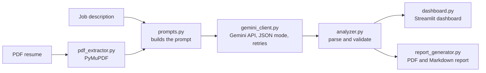

 AI-Powered Resume Analyzer & Job Matcher

A web app that uses **Generative AI** to compare a resume with a job description. It shows an estimated match score, the skills you already have, the skills you are missing, and ways to improve your resume, without inventing anything you do not have.

 Note: The score is an AI-generated estimate based on clear criteria (listed below). It is not an official ATS score.

 Features

- Resume upload: PDF only, with checks for empty, damaged, password-protected, scanned (image-only) and very large files
- Job description input: paste any job description
- AI analysis with Google Gemini: match score, matching and missing skills, relevant experience, education comparison, strengths and weaknesses
- Transparent scoring: the 100-point score is split into 5 clear criteria and is re-added by the code, not trusted blindly from the AI
- Improvement suggestions: missing keywords, skills to highlight, a rewritten professional summary, better bullet points and formatting tips
- Results dashboard: score card, score breakdown, skills summary, experience and education sections, and recommendation tabs
- Downloadable report: PDF and Markdown
- Safe by design: the AI is told never to invent skills, degrees, jobs or numbers

Tech Stack

| Purpose | Technology |
|---|---|
| Language | Python |
| AI model | Google Gemini API (`google-genai`) |
| Web interface | Streamlit |
| PDF reading and PDF report | PyMuPDF |
| Configuration | python-dotenv (`.env` file) |
| Testing | pytest |
| Version control | Git and GitHub |

How It Works



Each file has one job, so the code stays easy to read, test and change. The Streamlit app (`app.py`) never talks to Gemini directly. It only calls `analyzer.py`.

 Project Structure

```
ai-resume-analyzer/
├── app.py                    # Streamlit app (what the user sees)
├── src/
│   ├── config.py             # Settings and API key loading
│   ├── pdf_extractor.py      # PDF to text, with file checks
│   ├── prompts.py            # Prompt templates and score criteria
│   ├── gemini_client.py      # Gemini API calls, retries, friendly errors
│   ├── analyzer.py           # Runs the analysis and validates the AI reply
│   ├── dashboard.py          # Results dashboard
│   ├── report_generator.py   # PDF and Markdown reports
│   └── utils.py              # Small shared helpers
├── tests/
│   ├── test_pdf_extractor.py
│   ├── test_analyzer.py
│   ├── test_gemini_client.py
│   └── live_check.py         # Optional check with the real Gemini API
├── sample_data/              # Sample job descriptions
├── requirements.txt
├── requirements-dev.txt
├── .env.example
└── README.md
```

 How the Score Works

The AI gives points for each part, and the code adds them up (each part is also limited to its maximum):

| Criteria | Maximum points |
|---|---|
| Skills match | 40 |
| Experience relevance | 25 |
| Education fit | 15 |
| Keyword coverage | 10 |
| Resume clarity | 10 |
| **Total** | **100** |

 Setup and Installation

**You need:** Python 3.10 or newer and a free Gemini API key from [Google AI Studio](https://aistudio.google.com/apikey).

```bash
# 1. Get the code
git clone https://github.com/sumayyaarif27/ai-resume-analyzer.git
cd ai-resume-analyzer

# 2. Create and activate a virtual environment
python -m venv venv
source venv/Scripts/activate      # Windows (Git Bash)
# venv\Scripts\activate           # Windows (Command Prompt or PowerShell)
# source venv/bin/activate        # Mac / Linux

# 3. Install the packages
pip install -r requirements.txt

# 4. Add your API key
cp .env.example .env
# Open .env and replace your_api_key_here with your real key

# 5. Run the app
python -m streamlit run app.py
```

The app opens at `http://localhost:8501`. Upload a PDF resume, paste a job description and click **Analyze Resume**.

Testing

```bash
pip install -r requirements-dev.txt
python -m pytest -v
```

The automated tests use a fake Gemini, so they need no internet or API key. They cover:

- Valid, empty, non-PDF, damaged, password-protected, text-less and oversized PDFs
- Missing or too-short job descriptions and missing resumes
- Malformed AI replies (broken JSON, wrong format, missing fields)
- API failures: rate limits with retries, busy server, wrong API key, wrong model, no internet, empty reply
- Score re-calculation and limits
- Resume text that tries to give instructions to the AI (prompt injection)

Live check (optional): `python -m tests.live_check` runs the real Gemini API on a resume at `sample_data/resume.pdf` (use your own, it is not included). It checks that a good match scores high, a poor match scores low, and two runs of the same job give similar scores. It also looks for claims that are not supported by the resume (skills with no trace in the resume, bullet points not copied from the resume, and numbers that were not there).

Privacy and Safety

- The API key lives in `.env`, which is excluded from Git. `.env.example` shows what is needed.
- Resumes are processed in memory. The app does not save uploaded files.
- Text from the resume and job description is treated as **data, never as instructions**. Special tags are removed so they cannot break the prompt, and nothing from a document is ever executed.
- The AI is instructed to use only facts written in the resume, and recommendations are reminders to only add what is true.
- Reports can contain details taken from a resume, so keep them private. Report files are excluded from Git.

Limitations

- The score is an estimate from an AI model, not an official ATS score. Scores can change by a few points between runs.
- Only text-based PDFs are supported (no scanned images or OCR), up to 5 MB.
- The analysis depends on how clearly the resume and job description are written.
- Free Gemini API limits apply. When the limit is reached, the app retries and then shows a clear message.
- The AI model name is set in `src/config.py` and may need updating when Google changes its models.

Troubleshooting

- `streamlit` says "Permission denied" on Windows: use `python -m streamlit run app.py` (as shown above).
- "DLL load failed ... Application Control policy" error: Windows security can block some compiled packages. The dashboard uses only built-in Streamlit widgets to avoid this.
- "Model not found": check `MODEL_NAME` in `src/config.py` against the models shown in Google AI Studio.

Future Improvements

- Support for DOCX resumes and OCR for scanned PDFs
- Compare one resume against several jobs at once
- Keep a history of analyses
- Deploy the app online

Author

Built by **Sumayya Mahammad Arif** as a GenAI portfolio project.